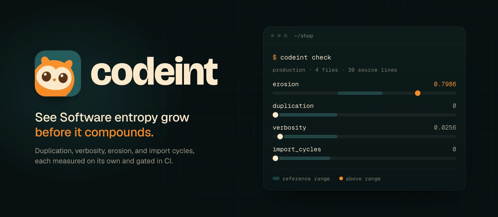

<h1 align="center">
  
</h1>

<p align="center">
  <a href="https://github.com/avidianity/codeint/actions/workflows/ci.yml"></a>
  <a href="https://github.com/avidianity/codeint/releases/latest"></a>
  <a href="https://www.npmjs.com/package/codeint"></a>
  <a href="./LICENSE"></a>
</p>

codeint measures the Software entropy of a codebase: duplication, needless verbosity, and complexity concentrated in a few large functions.
It is for developers whose code is increasingly written by coding agents, so they see Software entropy grow before it compounds.

codeint reports each Metric on its own, with the Findings behind it, and never blends them into one score.
It gates CI on per-Metric Budgets and on Regressions against a base Git ref.
Languages and Metrics are Plugins: TypeScript/JavaScript, Rust, PHP, and Dart ship as built-in Language plugins, and third-party languages and Metrics load as WebAssembly Plugins.

<p align="center">
  <a href="#install">Install</a> ·
  <a href="#use">Use</a> ·
  <a href="#configure">Configure</a> ·
  <a href="#what-to-expect">What to expect</a> ·
  <a href="#github-actions">GitHub Actions</a> ·
  <a href="./docs/reference.md">Reference</a> ·
  <a href="./docs/plugins.md">Plugins</a> ·
  <a href="#development">Development</a>
</p>

[GLOSSARY.md](./GLOSSARY.md) defines every term on this page.

## Install

Install the standalone binary (macOS, Linux, Windows) or run directly with `npx`:

```sh
curl -fsSL https://github.com/avidianity/codeint/releases/latest/download/install.sh | bash
```

```powershell
irm https://github.com/avidianity/codeint/releases/latest/download/install.ps1 | iex
```

```sh
npx codeint check
```

## Use

Run codeint inside a Git repository:

```sh
codeint init
codeint check
codeint diff main
codeint trend
codeint update
```

`codeint init` writes a starter `codeint.json`.
`codeint check` measures the working tree and prints each Metric with its Findings.
`codeint diff main` compares the working tree with the merge-base of `main`, and fails on a Regression.
`codeint trend` prints each Metric for each commit of the main line.
`codeint update` verifies SHA-256 checksums and updates a standalone binary in place from GitHub Releases.

[docs/reference.md](./docs/reference.md) documents every command, option, exit code, report format, and `codeint.json` key, with an example for each.
[docs/plugins.md](./docs/plugins.md) explains how to build, hash, declare, and test Language plugins and Metric plugins against the versioned WIT contract.

## Configure

Run `codeint init` at the root of your Git repository to create a starter `codeint.json` pinned to your installed version's `$schema` for editor autocomplete.
`codeint update` keeps that versioned `$schema` URL in sync when you upgrade.
Without `codeint.json`, codeint measures every supported language with default settings and no hard Budgets.

```json
{
  "$schema": "https://raw.githubusercontent.com/avidianity/codeint/v0.1.0/schema/codeint.schema.json",
  "source_sets": {
    "generated": ["src/**/*.generated.ts"],
    "vendored": ["vendor/**"]
  },
  "budgets": {
    "production": {
      "erosion": 0.35,
      "duplication": 0.08,
      "verbosity": 0.08,
      "import_cycles": 0.05
    }
  },
  "regression_limits": {
    "generated": {
      "duplication": { "ratio_rise": 1, "new_findings": "never" }
    }
  },
  "languages": [
    { "plugin": "typescript-javascript", "include": ["web"], "exclude": ["web/dist"] },
    { "plugin": "rust", "include": ["crates"], "exclude": [] },
    { "plugin": "php", "include": ["app", "src"], "exclude": [] },
    { "plugin": "dart", "include": ["lib"], "exclude": [] }
  ]
}
```

- **`source_sets`**: classify paths into `production`, `test`, `generated`, or `vendored` using globs (overrides built-in rules).
- **`budgets`**: hard maximum ratios (`0` to `1`) per Source set and Metric; `codeint check` and `codeint diff` exit `1` when exceeded.
- **`regression_limits`**: per-Metric or per-Source-set limits for `codeint diff` (`ratio_rise` defaults to `0.01`; `new_findings` accepts `any_new_finding`, `numerator_rise_with_new_findings`, or `never`).
- **`languages`**: scope built-in Language plugins (`typescript-javascript`, `rust`, `php`, `dart`) or external plugins to specific folders and exclusions.
- **`plugins`** and **`plugin_limits`**: load external WebAssembly Language or Metric plugins with SHA-256 verification and memory/time caps.

See [docs/reference.md#codeintjson](./docs/reference.md#codeintjson) for every key, default value, and tested example.

## What to expect

codeint measures four independent Production Metrics without blending them into one score:

- **Erosion**: share of Function mass in functions with cyclomatic complexity over 10
- **Duplication**: share of source lines in Clone groups
- **Verbosity**: share of source lines in Flagged lines or Clone groups
- **Import cycles**: share of modules in an Import cycle

### Calibrated Reference ranges

Measured across 20 pre-2023 open-source repositories per language (10th–90th percentile; [ADR 0008](./docs/adr/0008-typescript-reference-ranges.md), [ADR 0010](./docs/adr/0010-rust-reference-ranges.md), [ADR 0011](./docs/adr/0011-php-reference-ranges.md), [ADR 0012](./docs/adr/0012-dart-reference-ranges.md)):

| Language | Erosion | Duplication | Verbosity | Import cycles |
| -------- | ------- | ----------- | --------- | ------------- |
| TypeScript / JavaScript | 35.2%–60.0% | 1.7%–34.6% | 1.8%–34.7% | 0.0%–30.8% |
| Rust | 38.0%–64.2% | 5.0%–32.5% | 6.0%–32.9% | 2.1%–50.6% |
| PHP | 5.5%–67.7% | 4.1%–29.0% | 4.2%–29.2% | 0.0%–10.7% |
| Dart | 4.7%–41.9% | 7.3%–25.6% | 8.0%–25.9% | 7.3%–52.4% |

### Rust measurements and speed

Sample Production measurements from `codeint check` (release build, Apple Silicon):

| Repository | Files | Prod lines | Erosion | Duplication | Verbosity | Import cycles | Time |
| ---------- | ----- | ---------- | ------- | ----------- | --------- | ------------- | ---- |
| `avidianity/codeint` | 154 | 16,400 | 31.0% | 5.2% | 5.3% | 2.3% | 0.06s |
| `BurntSushi/ripgrep` | 105 | 24,961 | 36.4% | 31.1% | 31.3% | 29.3% | 0.07s |
| `sharkdp/fd` | 25 | 3,423 | 44.6% | 0.0% | 0.1% | 56.5% | 0.02s |
| `dtolnay/serde` | 189 | 19,425 | 45.7% | 40.2% | 40.2% | 0.0% | 0.06s |

### PHP measurements and speed

Sample Production measurements from `codeint check` (release build, Apple Silicon):

| Repository | Files | Prod lines | Erosion | Duplication | Verbosity | Import cycles | Time |
| ---------- | ----- | ---------- | ------- | ----------- | --------- | ------------- | ---- |
| `laravel/laravel` | 29 | 762 | 0.0% | 0.0% | 0.0% | 8.0% | 0.03s |
| `laravel/framework` | 3,208 | 132,791 | 16.9% | 8.1% | 8.2% | 4.4% | 0.47s |

### Dart measurements and speed

Sample Production measurements from `codeint check` (release build, Apple Silicon):

| Repository | Files | Prod lines | Erosion | Duplication | Verbosity | Import cycles | Time |
| ---------- | ----- | ---------- | ------- | ----------- | --------- | ------------- | ---- |
| `dart-lang/pub` | 547 | 26,170 | 44.4% | 0.5% | 1.7% | 78.6% | 0.88s |
| `flutter/packages` | 4,137 | 434,407 | 45.9% | 23.1% | 23.3% | 18.5% | 3.68s |

## GitHub Actions

Add `.github/workflows/codeint.yml` to run `codeint diff` on each pull request and upload its SARIF report to GitHub code scanning:

```yaml
name: codeint

on:
  pull_request:

permissions:
  contents: read
  security-events: write

jobs:
  codeint:
    runs-on: ubuntu-24.04
    steps:
      - uses: actions/checkout@3d3c42e5aac5ba805825da76410c181273ba90b1
        with:
          fetch-depth: 0
      - name: Install codeint
        run: |
          curl -fsSL https://github.com/avidianity/codeint/releases/latest/download/install.sh | bash
          echo "$HOME/.local/bin" >> "$GITHUB_PATH"
      - name: Diff against pull request base
        env:
          BASE_REF: ${{ github.base_ref }}
        run: codeint diff "origin/$BASE_REF" --format sarif --output codeint.sarif
      - name: Upload SARIF
        if: always() && hashFiles('codeint.sarif') != ''
        uses: github/codeql-action/upload-sarif@1bd86f2fdb4b86187fa4059f16f31a3202acc9ea
        with:
          sarif_file: codeint.sarif
```

`fetch-depth: 0` fetches the base branch history so `codeint diff` can find the merge-base.
`if: always() && hashFiles('codeint.sarif') != ''` uploads annotations even when a Budget or a Regression fails.

## Development

You need:

- Rust through rustup; [rust-toolchain.toml](./rust-toolchain.toml) selects the version.
- Node.js 24 and npm, for the development tools in [package.json](./package.json).
- gitleaks and lychee on your `PATH`, for the Git hook.

Set up a checkout:

```sh
npm ci
npx lefthook install
cargo test --workspace --locked
```

Agents and people follow the same rules: start with [.rules](./.rules).
The checks that guard the repository are listed in [docs/checks](./docs/checks/README.md).

## License

[MIT](./LICENSE)
